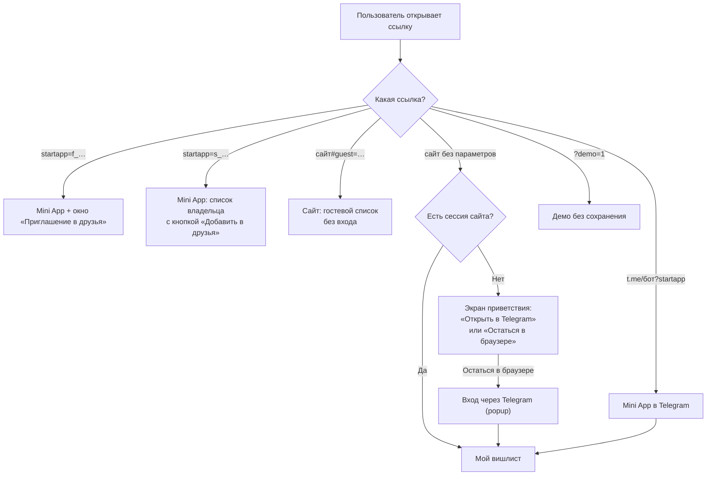

# 1. Текущее состояние продукта

> Этот файл описывает **только то, что реализовано в коде**. Оценки и предложения — в других файлах.

## 1.1 Роли

| Роль | Как попадает в продукт | Идентификация |
| --- | --- | --- |
| **Владелец списка** | Telegram Mini App или сайт с «Войти через Telegram» | Telegram-аккаунт |
| **Друг-даритель** | Тот же аккаунт Telegram; дружба подтверждена обеими сторонами | Telegram-аккаунт |
| **Даритель по Telegram-ссылке** | Ссылка `t.me/…?startapp=s_…` | Telegram-аккаунт, дружба не обязательна |
| **Гость** (пожилой родственник) | Ссылка на сайт `…#guest=…` в любом браузере | Только имя, введённое при брони. Аккаунта и памяти о госте нет |

Понятия «семья» в интерфейсе больше нет: миграция `0002` превратила членов семьи в друзей. Сейчас продукт оперирует «друзьями».

## 1.2 Точки входа

## 1.3 Навигация

Четыре раздела (`main.tsx:377-403`):

| Раздел | Что показывает |
| --- | --- |
| **Мой вишлист** | Свои активные желания, кнопки «Импорт» и «Добавить желание», «Поделиться вишлистом», «Управлять гостевыми бронями» |
| **Друзья** | Заявки, сетка друзей, по нажатию — список друга ниже на той же странице |
| **Мои брони** | Названия забронированных мной подарков + «Отменить бронь» |
| **Архив** | Исполненные желания: «Вернуть», «Удалить» |

- На ширине ≤ 740 px разделы спрятаны в выезжающее боковое меню (кнопка-гамбургер в шапке). Нижней навигации нет.
- В гостевом режиме все разделы, кроме «Друзья», неактивны (`main.tsx:389`); меню при этом открывается.
- Справа в шапке — чип с ником, открывающий «Мой профиль», и кнопка полноэкранного режима (Telegram Bot API 8.0+).
- Все второстепенные экраны — модальные окна (`Modal`, `forms.tsx:25`).

## 1.4 Инвентарь экранов и окон

| # | Экран / окно | Файл | Кто видит |
| --- | --- | --- | --- |
| S1 | Приветствие (не авторизован) | `main.tsx:472-523` | Все без входа |
| S2 | Вход на сайте через Telegram | `login.tsx` | Браузер |
| S3 | Мой вишлист | `main.tsx:557-886` | Владелец |
| S4 | Друзья: заявки + сетка друзей | `main.tsx:620-682`, `friends.tsx:171` | Авторизованный |
| S5 | Вишлист друга | `main.tsx:683-886` (режим `friend`) | Друг |
| S6 | Гостевой список | тот же экран, баннер «Гостевой список · без регистрации» | Гость |
| S7 | Мои брони | `main.tsx:887-948` | Авторизованный |
| S8 | Архив | `main.tsx:683-886` (режим `archive`) | Владелец |
| M1 | Новое / редактирование желания | `forms.tsx:152` `GiftForm` | Владелец |
| M2 | Импорт вишлиста (источник → листы → предпросмотр → готово) | `import/ImportDialog.tsx` | Владелец |
| M3 | Поделиться мечтами (2 постоянные ссылки) | `forms.tsx:740` `Share` | Владелец |
| M4 | Управлять гостевыми бронями | `forms.tsx:822` `GuestBookings` | Владелец |
| M5 | Добавить друга (по нику / по ссылке) | `friends.tsx:14` `AddFriend` | Авторизованный |
| M6 | Приглашение в друзья (принять) | `friends.tsx:255` `AcceptInvite` | Открывший `f_`-ссылку |
| M7 | Мой профиль, выход | `friends.tsx:320` `Profile` | Авторизованный |
| M8 | Гостевая бронь: «Кто будет покупать подарок?» | `main.tsx:971-1018` | Гость |
| M9 | Подтверждение «Вы уверены?» | `forms.tsx:105` `Confirm` | Удаление желания, удаление из друзей |

Глобальные состояния: тост на 4,5 с (`main.tsx:112`), плашка ошибки с кнопкой «Повторить» (`main.tsx:608`), индикатор «Собираем желания…».

## 1.5 Карточка желания

Одна компонента `GiftCard` (`main.tsx:1120`) в четырёх режимах:

| Режим | Элементы |
| --- | --- |
| `own` | фото, приоритет, карандаш (редактировать), цена, название, описание, «В магазин», **«Отправить в архив»**, корзина |
| `archive` | значок «Куплено · дата», «Вернуть», корзина |
| `friend` / `guest` | «В магазин», кнопка брони: **«Подарю!»** / **«Уже выбрали»** (неактивна) / **«Отменить бронь»** (только у друга для своей брони) |

Без описания на карточке выводится текст «Ещё одна маленькая мечта.», без ссылки — «Выбрано с любовью».

## 1.6 Матрица действий (что реально умеет код)

| Действие | Владелец | Друг | Даритель по `s_`-ссылке | Гость |
| --- | --- | --- | --- | --- |
| Видеть список | свой | друга | владельца ссылки | владельца ссылки |
| Видеть статус брони | ❌ (кроме гостевых в M4) | ✅ свободно / моя / занято | ✅ | ✅ свободно / занято (без «моя») |
| Забронировать | ❌ | ✅ | ✅ | ✅ по имени |
| Отменить свою бронь | — | ✅ с карточки и в «Моих бронях», без подтверждения | ✅ | ❌ |
| Отменить чужую бронь | только гостевую (M4) | ❌ | ❌ | ❌ |
| Добавить / изменить / архивировать / удалить желание | ✅ | ❌ | ❌ | ❌ |
| Импорт из таблицы | ✅ | — | — | — |
| Поделиться списком | ✅ 2 ссылки | — | — | — |
| Добавить в друзья | по нику / ссылке-приглашению | то же | кнопка «Добавить в друзья · Имя» | ❌ |

## 1.7 Реализованные пользовательские сценарии

| Сценарий | Статус | Комментарий |
| --- | --- | --- |
| Вход через Telegram Mini App | ✅ | Без лишних шагов |
| Вход на сайте через Telegram (OIDC popup) | ✅ | Нужны всплывающие окна |
| Добавление желания вручную | ✅ | Обязательно только название |
| Автозаполнение по ссылке на магазин | ✅ частично | По README крупные маркетплейсы часто блокируют |
| Импорт из Google Таблицы / xlsx / csv | ✅ | 4 шага с предпросмотром |
| Редактирование, архив, возврат, удаление | ✅ | Удаление с подтверждением |
| Поиск и сортировка списка | ✅ | |
| Бронирование другом | ✅ | Атомарно, тайно от владельца |
| Отмена своей брони другом | ✅ | |
| Гостевая бронь по имени | ✅ | |
| Отмена гостевой брони гостем | ❌ | Только через владельца |
| Управление гостевыми бронями владельцем | ✅ | Видит названия и имена |
| Добавление друга по нику | ✅ | Человек должен хотя бы раз открыть приложение |
| Приглашение в друзья по ссылке | ✅ | 30 дней, одна активная ссылка |
| Поделиться списком: Telegram-ссылка и гостевая | ✅ | Постоянные, отзываемые |
| Уведомления (бот, push) о бронях, изменениях, заявках | ❌ | Не реализованы |
| Даты/поводы (день рождения), несколько списков | ❌ | Не реализованы |
