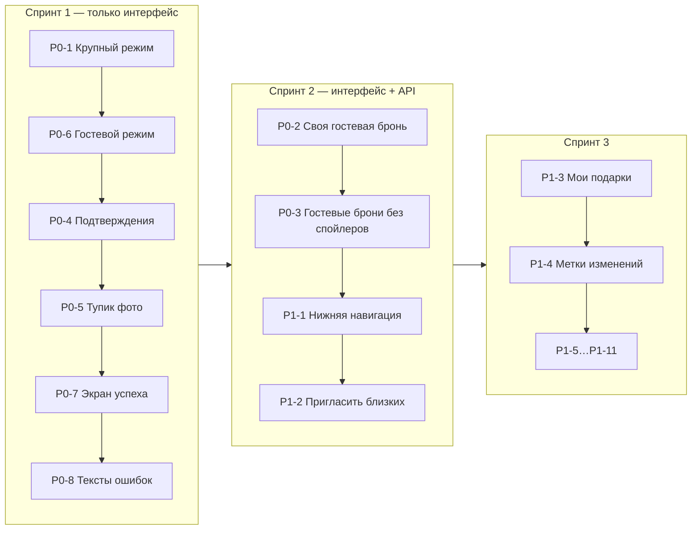

# 3. Улучшения UX с приоритетами

**Шкала:**
- **P0** — до показа сервиса пожилым родственникам. Без этого основной сценарий ломается или нарушается обещание «сюрприз останется сюрпризом».
- **P1** — заметно упрощает жизнь; делать сразу после P0.
- **P2** — полировка и рост; только если MVP уже работает.

Колонка «Объём»: **S** — только интерфейс, до дня; **M** — интерфейс + небольшая правка API; **L** — новая логика или схема БД.

Все пункты ниже — **предложения**, их нет в коде.

## P0 — критично

| # | Улучшение | Решает | Объём |
| --- | --- | --- | --- |
| P0-1 | **Крупный режим по умолчанию на телефоне.** Базовый шрифт 16 px, вторичный ≥ 14 px, ни одного текста < 12 px. Кнопки ≥ 48 px по высоте. Карточки в **1 колонку** до 600 px | A-1, A-2, A-3, GR-5, RS-9 | S |
| P0-2 | **Гость видит и отменяет свою бронь на том же устройстве.** Ответ `POST /api/guest-reservations/:id` возвращает секретный ключ отмены; страница хранит его в `localStorage` с именем. Метка «Это дарите вы», кнопка «Передумал» с подтверждением. Без ключа (другое устройство) — как сейчас | GR-1, GR-2, CR-3 | M |
| P0-3 | **Не раскрывать сюрприз владельцу в «Гостевых бронях».** По умолчанию — только «Мария · 2 подарка» и «Отменить все брони Марии»; названия — по кнопке «Показать подарки» с предупреждением. Плашку о приватности переформулировать честно: «Брони друзей скрыты. Гостевые можно посмотреть, если гость попросит помочь» | CR-4, CR-5 | S–M |
| P0-4 | **Подтверждение брони и отмены.** Нижний лист: фото, название, «Да, я подарю» / «Да, отменить». Тот же компонент `Confirm`, не `window.confirm` — заменить его и в «Поделиться», и в «Гостевых бронях» | RS-1, RS-2, CR-1, CR-6 | S |
| P0-5 | **Снять тупик в редактировании.** Ошибка загрузки фото не блокирует «Сохранить»; сообщение «Фото не загрузилось, остальное можно сохранить» | MW-1 | S |
| P0-6 | **Упрощённый гостевой режим.** Без меню, чипа профиля, декоративного блока, футера; одна строка-инструкция сверху; поиск и сортировка — только при > 12 желаниях | GR-6, GR-7, GR-9, X-5, A-5 | S |
| P0-7 | **Экран успеха после брони** вместо тоста: «Готово! Анастасия не узнает», «Где купить», «Мои подарки» / «Вернуться к списку» | GR-3, RS-5 | S |
| P0-8 | **Понятные тексты ошибок с действием.** Конфликт: «Пока вы смотрели, этот подарок выбрал кто-то другой». Нет доступа к гостевой ссылке: «Ссылка больше не работает. Попросите прислать новую». У ошибок — значок ⚠, не ✓ | E-1, E-2, E-6, GR-8 | S |

## P1 — важно

| # | Улучшение | Решает | Объём |
| --- | --- | --- | --- |
| P1-1 | **Нижняя навигация** из 3 пунктов на телефоне: «Мой список» · «Близкие» · «Мои подарки». «Архив» — внутри «Моего списка» (вкладка или ссылка внизу). Профиль — аватар в шапке | A-4, IN-6 | S |
| P1-2 | **Одна точка «Пригласить близких»** с вопросом «Есть ли у человека Telegram?» и кнопкой «Отправить» (Telegram share / `navigator.share`) с готовым текстом-инструкцией. Копирование — запасное, с видимым результатом | IN-1, IN-2, IN-3 | S–M |
| P1-3 | **«Мои подарки» вместо «Моих броней»:** для кого, фото, цена, «В магазин», «Отменить» с подтверждением; группировка по получателю | RS-6 | M |
| P1-4 | **Метки для дарителя:** «Желание изменилось после вашего выбора» (сравнить `gifts.updated_at` и `reservations.created_at`) и «Желание удалено владельцем» (нужна мягкая запись) | MW-5, MW-6, CR-7 | M–L |
| P1-5 | **Список близкого — отдельный экран** с «← Близкие», «Убрать из близких» — в меню «⋯» | RS-3, RS-4, RS-8 | S |
| P1-6 | **Форма желания: название первым**, ссылка вторым, остальное в «Подробнее»; на телефоне одна кнопка «Добавить фото»; приоритет — 3 сегмента; валюта запоминается; «Выйти без сохранения?» | AW-1…AW-5, A-7 | S |
| P1-7 | **Undo в тосте** (7 с) после архивации и отмены брони; тосты ошибок держать до закрытия | CR-2, MW-3, A-6 | S |
| P1-8 | **Ссылка-приглашение в друзья: многоразовая и повторно копируемая** (хранить значение, как у ссылок на список), «Заменить» — только в управлении ссылками | IN-4 | M |
| P1-9 | **Карточка владельца — только просмотр**, действия на экране желания: «Изменить», «Уже подарили», «⋯» (удалить). Честный значок «В архиве · дата» | MW-2, MW-4 | S |
| P1-10 | **Терминология:** «Друзья» → «Близкие», «Подарю!» → «Подарю», «Отправить в архив» → «Уже подарили», «Уже выбрали» → «Уже выбрал кто-то другой» | X-3, X-4 | S |
| P1-11 | **Загрузка без мигания:** состояние загрузки для списка близких, скелетоны карточек | X-7, X-10 | S |

## P2 — полезно, но не для MVP

| # | Улучшение | Решает | Объём |
| --- | --- | --- | --- |
| P2-1 | Уведомления через бота: входящая заявка, «ваш подарок изменён/удалён». Без уведомлений владельцу о бронях | IN-6, MW-6 | L |
| P2-2 | Добавление по нику без предварительного входа: заявка «ждёт», пока человек впервые откроет приложение | IN-5 | M |
| P2-3 | Pull-to-refresh и автообновление списка при возврате во вкладку | MW-8 | S |
| P2-4 | Импорт из таблицы — убрать с главного экрана в профиль и пустое состояние | MW-10 | S |
| P2-5 | Подсказки первого запуска (3 экрана) для владельца: добавить желание → пригласить → как работают брони | — | S |
| P2-6 | Подсветка нового желания, счётчик «Осталось мест» при ≤ 10 | AW-6, AW-8 | S |
| P2-7 | Пустое состояние у близкого без желаний: «Напомнить» (поделиться ссылкой на бота) | X-9 | S |
| P2-8 | Уважение системной настройки крупного шрифта (`rem`, без фиксированных px) | A-1 | M |

## Чего сознательно **не** предлагаем для MVP

- Несколько списков, поводы и даты, групповые подарки со сбором денег, комментарии, чат.
- Регистрацию гостей и личный кабинет гостя.
- Показ владельцу, что желание забронировано (даже косвенно) — это главная ценность продукта.
- Сложные фильтры и категории.

## Предлагаемый порядок работ

**Как проверить результат:** дать 3 пожилым родственникам гостевую ссылку на их телефонах без подсказок и попросить «выберите любой подарок, а потом передумайте». Успех — все трое справились без помощи меньше чем за 2 минуты.
