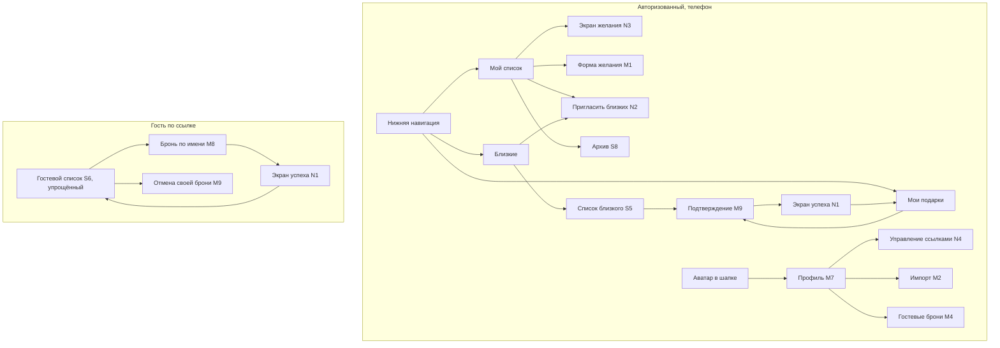

# 4. Экраны: оставить, изменить, добавить

Коды экранов — из [01-current-state.md](01-current-state.md#14-инвентарь-экранов-и-окон). Цель — **не увеличить** число экранов, а сделать каждый проще. Итог: 6 экранов оставить с правками, 2 объединить, 4 небольших добавить; ни одной новой крупной функции.

## 4.1 Оставить (с небольшими правками или без)

| Экран | Решение | Что поправить |
| --- | --- | --- |
| S2 Вход на сайте через Telegram | Оставить | Ок как есть. Добавить подсказку, что делать, если всплывающие окна заблокированы на телефоне |
| M2 Импорт вишлиста | Оставить | Перенести вход в профиль / пустое состояние (P2-4) |
| M6 Приглашение в друзья (принять) | Оставить | Кнопка «Открыть список Анны» после принятия; при ошибке — «Закрыть» и «Мой список» |
| M7 Мой профиль | Оставить | Добавить «Импорт», «Управление ссылками», «Архив»; выход — без изменений |
| M9 Подтверждение | Оставить и **расширить** | Единственный способ подтверждать: бронь, отмена брони, архив, удаление, отзыв ссылки. Вывести как нижний лист на телефоне |
| S8 Архив | Оставить | Честный значок «В архиве · дата» вместо «Куплено»; доступ из «Моего списка» |

## 4.2 Изменить

| Экран | Что меняется | Приоритет |
| --- | --- | --- |
| **Навигация** (сайдбар) | На телефоне — нижняя панель из 3 пунктов: «Мой список», «Близкие», «Мои подарки». На компьютере сайдбар можно оставить | P1 |
| **S1 Приветствие** | Одна главная кнопка «Открыть в Telegram»; «Остаться в браузере» — второстепенная кнопка, не `
`; убрать «Посмотреть интерфейс» в продакшене | P1 |
| **S3 Мой вишлист** | Убрать декоративный блок с первого экрана (оставить как компактную плашку); крупные «+ Добавить желание» и «Пригласить близких»; карточки в 1 колонку; поиск/сортировка при > 12 | P0/P1 |
| **Карточка желания** | 1 колонка на телефоне, шрифт ≥ 16 px. Владелец: только просмотр, тап → экран желания. Даритель: одна крупная кнопка «Подарю» / метка «Это дарите вы» / «Уже выбрал кто-то другой». Убрать выдуманное описание | P0 |
| **S4 Друзья → «Близкие»** | Список строк (имя, количество желаний), заявки сверху крупно, кнопка «Пригласить близких». Показывать загрузку | P1 |
| **S5 Вишлист друга** | Отдельный экран с «← Близкие»; «Убрать из близких» в меню «⋯» | P1 |
| **S6 Гостевой список** | Упрощённый режим: без меню, профиля, декора и футера; инструкция одной строкой; свои брони отмечены | P0 |
| **S7 Мои брони → «Мои подарки»** | Карточки с фото, для кого, ценой, «В магазин», «Отменить» с подтверждением; метки «изменено» / «удалено» | P1 |
| **M1 Форма желания** | Название первым; «Подробнее» свёрнуто; одна кнопка фото на телефоне; приоритет сегментами; не блокировать сохранение ошибкой фото; «Выйти без сохранения?» | P0 (фото) / P1 |
| **M4 Гостевые брони** | По умолчанию без названий подарков; «Показать подарки» с предупреждением; свои подтверждения; тост после действия | P0 |
| **M8 Гостевая бронь** | Фото и название подарка в окне, имя подставлено из прошлого раза, крупная кнопка «Да, я подарю» | P0 |
| **M3 Поделиться** + **M5 Добавить друга** | **Объединить** в один экран «Пригласить близких» (см. 4.3) | P1 |

## 4.3 Добавить

| Новый экран | Зачем | Из чего собирается | Приоритет |
| --- | --- | --- | --- |
| **N1 Экран успеха брони** | Подтвердить действие и дать следующий шаг | Существующие данные карточки; ссылка в магазин | P0 |
| **N2 Пригласить близких** | Одна точка вместо M3 + M5 | Существующие ссылки `s_`, `#guest`, приглашение `f_`, поиск по нику; кнопка «Отправить» | P1 |
| **N3 Экран желания** | Крупные действия для владельца и подробности для дарителя вместо тесной карточки | Существующие поля `gifts` | P1 |
| **N4 Управление ссылками** (в профиле) | Отзыв и замена ссылок вынесены из потока «поделиться» | Существующие `guest-links`, `friend-invites` | P1 |

## 4.4 Карта экранов после изменений

## 4.5 Чек-лист для каждого экрана (mobile-first, пожилые пользователи)

- [ ] Главное действие одно, видно без прокрутки, кнопка ≥ 48 px во всю ширину.
- [ ] Текст ≥ 16 px, вторичный ≥ 14 px, контраст ≥ 4.5:1.
- [ ] Иконки рядом с текстом, а не вместо него.
- [ ] У каждого действия, которое что-то меняет для другого человека, есть подтверждение или отмена.
- [ ] У каждой ошибки есть понятная причина и кнопка «что делать».
- [ ] Есть состояния: загрузка, пусто, ошибка, нет сети, успех.
- [ ] Никакой информации о бронях на экранах владельца (кроме явного запроса в M4).
