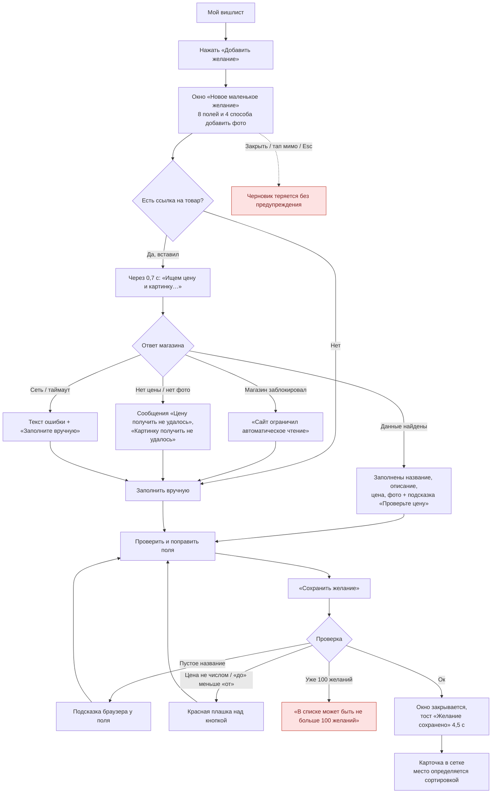
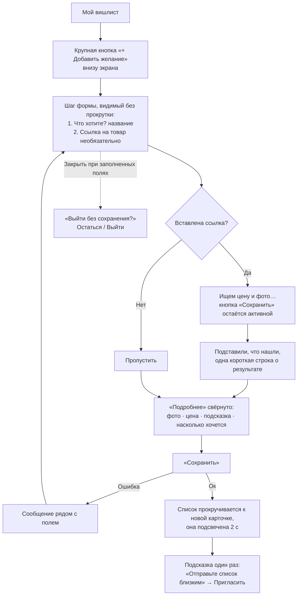

# Сценарий 1. Добавление желания

**Кто:** владелец списка. **Где:** «Мой вишлист» → «Добавить желание» → окно M1 (`GiftForm`, `forms.tsx:152`).

## Сейчас

Поля в форме сверху вниз: ссылка на магазин (+ кнопка обновления) → блок фото (файл / Ctrl+V / «Вставить из буфера» / ссылка на картинку + «Загрузить») → **название (обязательно)** → цена «Точная / От – до» + валюта → «Подсказка близким» → «Как сильно хочется?» → «Сохранить желание».

### Что работает хорошо

- Обязательно только название — желание можно сохранить за 5 секунд.
- Автозаполнение аккуратно не перетирает то, что человек ввёл руками (`LookupState`).
- Честные сообщения, когда магазин не отдал данные.
- Фото сжимается в браузере, есть понятная заглушка.

### Проблемы

| ID | Проблема | Где |
| --- | --- | --- |
| AW-1 | Главное поле (название) — пятое по счёту, ниже блока из 4 способов загрузки фото. На телефоне его не видно без прокрутки | `forms.tsx:432-590` |
| AW-2 | Подсказки «Ctrl+V», «Вставить из буфера» бесполезны на телефоне; «Ссылка на картинку» всегда видна и дублирует загрузку файла | `forms.tsx:505, 528-575` |
| AW-3 | Валюта по умолчанию всегда `EUR`, выбор не запоминается | `forms.tsx:170` |
| AW-4 | Закрытие окна (тап по фону, Esc, крестик) молча теряет заполненную форму | `forms.tsx:77-79` |
| AW-5 | Кнопка «Сохранить» заблокирована, пока идёт поиск по ссылке (до 12 с), без объяснения | `forms.tsx:697` |
| AW-6 | После сохранения новое желание не подсвечивается; при сортировке по приоритету может оказаться в середине списка | `main.tsx:1041-1045` |
| AW-7 | Ошибки валидации цены показываются внизу, далеко от поля | `forms.tsx:690` |
| AW-8 | Нет подсказки, сколько желаний осталось до лимита 100 | `worker/index.ts:41` |

## Предложение

Принцип: **«название — и готово»**. Всё остальное — по желанию, ниже, свёрнуто.

**Изменения формы (без новых функций):**

- Порядок: название → ссылка → «Подробнее» (фото, цена, подсказка, приоритет).
- Фото на телефоне: одна кнопка «Добавить фото» (системный выбор: камера / галерея). Блок «Ссылка на картинку» и «Вставить из буфера» — только на компьютере или внутри «Ещё способы».
- Валюта: запоминать последнюю выбранную на устройстве.
- Приоритет: три крупные кнопки-сегмента вместо выпадающего списка («Будет приятно / Очень хочется / Мечта»).
- Сохранение не блокировать поиском по ссылке: если пользователь сохранил раньше, сохранить то, что есть.
- Подтверждение при закрытии формы с несохранёнными изменениями.
- Счётчик «Осталось мест: 12» показывать, только когда осталось ≤ 10.
