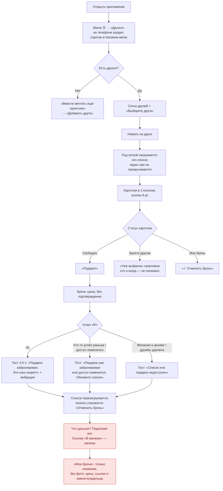
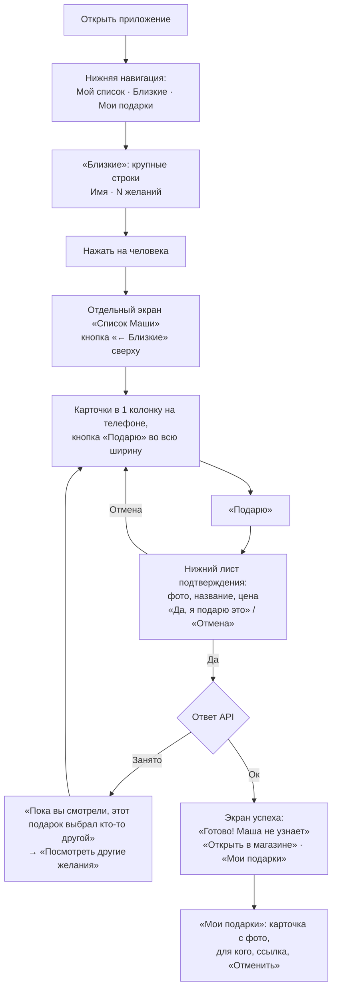

# Сценарий 2. Бронирование подарка (друг в Telegram)

**Кто:** друг владельца или человек, открывший Telegram-ссылку на список (`s_…`). **Где:** «Друзья» → выбрать друга → карточка → «Подарю!».

## Сейчас

Бронь создаётся сразу по нажатию, без подтверждения (`main.tsx:282-303`). На сервере — атомарная запись с проверкой доступа (`worker/index.ts:746-794`). Владелец бронь не видит.

### Что работает хорошо

- Гонка двух дарителей исключена на уровне БД.
- Тайна брони соблюдена: владелец ничего не узнаёт из API.
- Отмена своей брони возможна даже после удаления из друзей.

### Проблемы

| ID | Проблема | Где |
| --- | --- | --- |
| RS-1 | Нет подтверждения брони: случайное касание на маленьком экране = бронь | `main.tsx:282` |
| RS-2 | Кнопка «Отменить бронь» на карточке с иконкой ✓ — выглядит как «готово», а нажатие отменяет бронь **без подтверждения** | `main.tsx:1232-1236` |
| RS-3 | После выбора друга список появляется ниже сетки друзей, экран не прокручивается. На телефоне кажется, что ничего не произошло | `main.tsx:254-267, 683` |
| RS-4 | Нет кнопки «Назад к друзьям»; повторное нажатие на друга ничего не снимает | `main.tsx:640-658` |
| RS-5 | После брони нет следующего шага: «Купить в магазине», «Посмотреть мои брони» | `main.tsx:294-298` |
| RS-6 | «Мои брони» не показывают, **чей** это подарок, фото, цену и ссылку в магазин; из брони нельзя открыть карточку | `main.tsx:896-908`, `worker/index.ts:796-807` |
| RS-7 | «Уже выбрали» не различает, забронировал ли друг или гость — даритель не понимает, стоит ли договориться | `worker/index.ts:150` |
| RS-8 | Кнопка «Убрать из друзей» стоит в шапке списка друга рядом с основным контентом | `main.tsx:725-733` |
| RS-9 | На телефоне карточки идут в 2 колонки ~160 px, текст 9–10 px: прочитать и попасть по кнопке трудно | `style.css:614, 696, 736` |

## Предложение

**Ключевые изменения:**

- Подтверждение брони — один нижний лист с крупной кнопкой.
- Экран успеха вместо тоста: что произошло + следующий шаг.
- Список человека — отдельный экран с «Назад», а не блок под сеткой.
- «Мои подарки» = полноценные мини-карточки: имя получателя, фото, цена, «В магазин», «Отменить» (с подтверждением).
- «Убрать из близких» перенести в меню «⋯» на экране человека.
