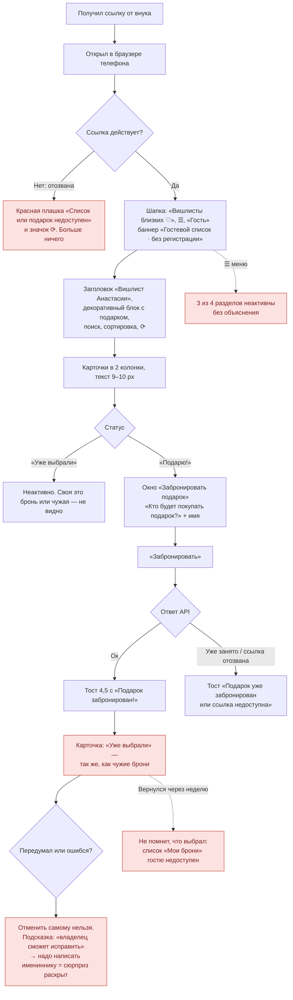
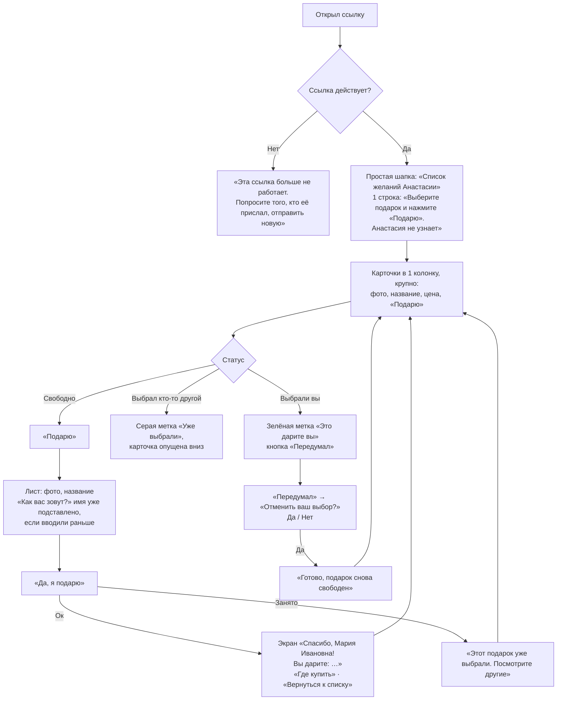

# Сценарий 3. Гостевое бронирование без регистрации

**Кто:** пожилой родственник без Telegram (или не желающий входить). **Где:** ссылка `https://…/#guest=…`, которую владелец скопировал в окне «Поделиться мечтами» и отправил в мессенджере, по SMS или почте.

Это самый важный сценарий для целевой аудитории: человек впервые видит сервис, у него нет аккаунта и, возможно, мало опыта со смартфоном.

## Сейчас

### Что работает хорошо

- Действительно без регистрации: только имя.
- Ссылка постоянная, её можно сохранить в закладки или переслать.
- Гость видит весь активный список и что уже выбрано — повторных подарков не будет.
- Владельца предупреждают перед копированием гостевой ссылки.

### Проблемы

| ID | Проблема | Почему критично для пожилых | Где |
| --- | --- | --- | --- |
| GR-1 | Гость не отличает свою бронь от чужой | Не помнит, что именно выбрал; может решить, что «не получилось» | `worker/index.ts:150` (`guestView` → всегда `reserved`) |
| GR-2 | Гость не может отменить бронь | Единственный путь — попросить владельца, а это раскрывает сюрприз | `main.tsx:1007-1009`, `forms.tsx:822` |
| GR-3 | Подтверждение — только тост на 4,5 с | Легко пропустить; нет экрана «что дальше» | `main.tsx:988` |
| GR-4 | Имя не запоминается между визитами | Каждый раз вводить заново | `main.tsx:107` |
| GR-5 | Мелкий шрифт, две колонки, кнопка 9 px | Не прочитать без очков, промахи по кнопкам | `style.css` |
| GR-6 | Лишние элементы: ☰ с неактивными пунктами, «Гость ▾», поиск, сортировка, ⟳, декоративный блок, «Сделано для нашей семьи» | Внимание уходит не туда, первый подарок ниже первого экрана | `main.tsx:366-468, 686-760, 779-827` |
| GR-7 | Нет объяснения, что это и что делать | Человек не понимает, зачем его сюда прислали | `main.tsx:526-540` |
| GR-8 | Отозванная ссылка = красная плашка без выхода | Тупик: непонятно, к кому обратиться | `main.tsx:608-619` |
| GR-9 | Подсказка «Для бронирования достаточно вашего имени» спрятана во втором абзаце декоративного блока | Ключевое сообщение не замечают | `main.tsx:703-704` |
| GR-10 | Если гость нажал «В магазин», его выбрасывает в магазин в новой вкладке, вернуться сложно | Пожилые теряются между вкладками | `main.tsx:1171-1178` |

## Предложение

Отдельный **упрощённый гостевой режим** на той же странице — без новых сущностей в БД, кроме возможности распознать «свою» гостевую бронь (см. P0-2 в рекомендациях).

**Ключевые изменения:**

- В гостевом режиме скрыть меню, чип профиля, поиск/сортировку (при < 15 желаний), декоративный блок, футер.
- Одна строка-инструкция наверху, крупным шрифтом.
- Карточки в одну колонку, шрифт ≥ 16 px, кнопка ≥ 48 px.
- Свою бронь гость видит и может отменить на том же устройстве. Минимальная реализация для MVP: при брони сервер возвращает одноразовый ключ отмены, страница хранит его в `localStorage` рядом с именем. Без ключа поведение остаётся как сейчас.
- Экран-подтверждение вместо тоста.
- Понятный текст для отозванной ссылки. Имя владельца по недействительному токену узнать нельзя, поэтому текст нейтральный: «попросите того, кто прислал ссылку».
