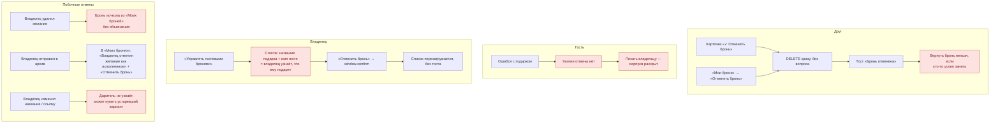

# Сценарий 4. Отмена брони

Отмена есть у трёх ролей, и у каждой — свой путь.

| Кто отменяет | Путь сейчас | Подтверждение |
| --- | --- | --- |
| Друг / даритель по Telegram | Карточка «✓ Отменить бронь» **или** «Мои брони» → «Отменить бронь» | ❌ нет |
| Гость | Не может | — |
| Владелец (только гостевые брони) | «Мой вишлист» → «Управлять гостевыми бронями» → «Отменить бронь» | `window.confirm` |
| Неявно: владелец удалил желание | Бронь удаляется каскадом (`ON DELETE CASCADE`) | Дарителя никто не предупреждает |

## Сейчас

### Проблемы

| ID | Проблема | Где |
| --- | --- | --- |
| CR-1 | Отмена брони другом — без подтверждения, одним касанием, в т. ч. с карточки | `main.tsx:282-303, 909-928` |
| CR-2 | Нет «Вернуть» (undo) после отмены | `main.tsx:923` |
| CR-3 | Гость не может отменить сам (см. сценарий 3) | `worker/index.ts:352-376` |
| CR-4 | Окно владельца для гостевых броней раскрывает сюрприз: названия + имена | `forms.tsx:858-866`, `worker/index.ts:809-819` |
| CR-5 | Противоречие: под кнопкой «Управлять гостевыми бронями» стоит плашка «Вы не видите бронирования своих подарков» | `main.tsx:761-777` |
| CR-6 | `window.confirm` в Telegram WebView ненадёжен — об этом прямо сказано в комментарии к `Confirm`, но в `GuestBookings` и `Share` используется именно он | `forms.tsx:104, 765, 801, 892` |
| CR-7 | Удаление желания молча уничтожает чужую бронь; даритель видит, что бронь «пропала» | `migrations/0001_initial.sql` (`ON DELETE CASCADE`) |
| CR-8 | Бронь архивного желания: формулировка «Отменить бронь» неуместна — подарок уже исполнен, нужна «Убрать из списка» | `main.tsx:904-927` |
| CR-9 | После отмены владельцем в M4 нет обратной связи (тоста) | `forms.tsx:834-849` |

## Предложение

```mermaid
flowchart TD
    subgraph FRIEND["Друг / гость со своей бронью"]
        A1["«Мои подарки» или карточка<br/>метка «Это дарите вы» → «Передумал»"] --> A2["Нижний лист: «Отменить выбор подарка<br/>«Наушники» для Маши?»<br/>«Да, отменить» / «Оставить»"]
        A2 -->|"Да"| A3["Тост «Подарок снова свободен»<br/>+ кнопка «Вернуть» 7 с"]
        A3 -->|"Вернуть"| A4["Повторная бронь,<br/>если ещё свободно"]
    end
    subgraph OWNER["Владелец: помощь гостю, не раскрывая сюрприз"]
        B1["Гость просит отменить"] --> B2["«Гостевые брони»: по умолчанию названия скрыты<br/>видно только «Мария · 1 подарок»"]
        B2 --> B3["Нажать «Показать подарки»<br/>с предупреждением «Вы увидите сюрприз»"]
        B3 --> B4["Отменить → своё окно подтверждения, не window.confirm"]
    end
    subgraph SIDE["Изменения владельцем"]
        C1["Удалил или изменил желание с бронью"] --> C2["В «Моих подарках» дарителя:<br/>«Желание удалено владельцем» / «Желание изменилось»<br/>с кнопкой «Понятно»"]
    end
```

**Ключевые изменения:**

- Единое подтверждение для отмены (свой компонент `Confirm`, не `window.confirm`).
- Undo в тосте на 7 секунд.
- Владелец по умолчанию видит только имена гостей и количество броней; названия — по явному действию.
- Не удалять бронь бесследно при удалении желания: оставить «след» для дарителя. Минимально — показывать в «Моих подарках» запись «Желание удалено владельцем» (потребует хранить название в брони или мягкое удаление).
