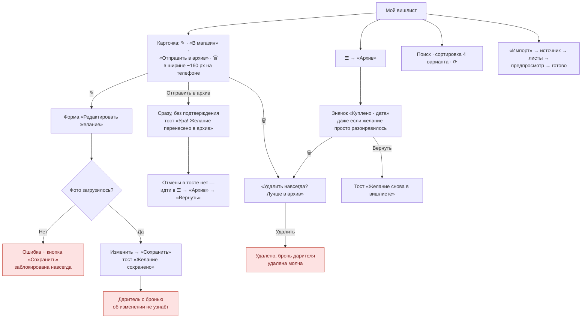
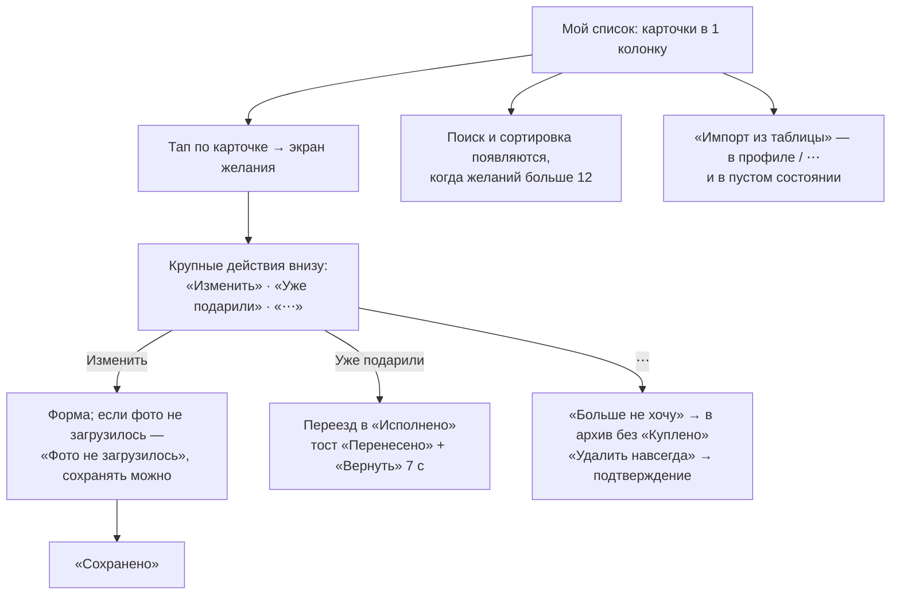

# Сценарий 5. Управление желаниями

**Кто:** владелец. **Действия:** редактировать, отправить в архив, вернуть из архива, удалить, найти, отсортировать, импортировать.

Владелец намеренно не видит брони (`worker/index.ts:137-145`), и все ответы API на изменение одинаковы независимо от брони. Это важное свойство продукта — его нужно сохранить в любых улучшениях.

## Сейчас

### Что работает хорошо

- Архив вместо удаления и понятное предупреждение перед удалением.
- Удаление — через собственное окно подтверждения.
- Импорт с предпросмотром и аккуратной нормализацией «неряшливых» таблиц.
- Сортировка по цене учитывает разные валюты.

### Проблемы

| ID | Проблема | Где |
| --- | --- | --- |
| MW-1 | **Тупик:** при ошибке загрузки фото в режиме редактирования `photoError = true`, кнопка «Сохранить» заблокирована, пока не загружено новое фото. Кнопки «Убрать фото» в этот момент нет (фото пустое), причина блокировки не объясняется. Изменить, например, только цену невозможно | `forms.tsx:225-228, 538-552, 697` |
| MW-2 | На карточке 4 действия в ~160 px; «Отправить в архив» и 🗑 рядом, 28–34 px высотой | `main.tsx:1182-1201`, `style.css:725, 1938` |
| MW-3 | «Отправить в архив» срабатывает сразу; отменить можно только через другой раздел | `main.tsx:304-310` |
| MW-4 | Формулировки расходятся: кнопка «Отправить в архив», тост «Ура!», значок «Куплено», заголовок «Исполненные мечты». Если желание просто неактуально, «Куплено» — неправда | `main.tsx:308, 560, 1158, 1191` |
| MW-5 | Удаление желания с бронью молча удаляет бронь дарителя (владелец этого знать не должен, но дарителю нужно сообщить) | см. сценарий 4, CR-7 |
| MW-6 | Редактирование желания с бронью не помечается для дарителя | `worker/index.ts:718-736` |
| MW-7 | Поиск и 4 варианта сортировки показаны даже при 2–3 желаниях | `main.tsx:779-827` |
| MW-8 | Ручное обновление ⟳ — единственный способ увидеть изменения; нет pull-to-refresh | `main.tsx:815-825` |
| MW-9 | На карточке без описания выводится «Ещё одна маленькая мечта.» — гость может принять это за описание от владельца | `main.tsx:1168` |
| MW-10 | Импорт («FileSpreadsheet Импорт») стоит рядом с главной кнопкой и конкурирует с ней; нужен очень малой доле пользователей | `main.tsx:588-594` |

## Предложение

**Ключевые изменения:**

- Карточка в списке — только просмотр + один тап для открытия; действия — на экране желания крупными кнопками.
- Две понятные причины архива: «Уже подарили» и «Больше не хочу». Для MVP достаточно одной кнопки «Убрать из списка» с честным значком «В архиве · дата» вместо «Куплено».
- Undo в тосте для архива.
- Снять блокировку сохранения при ошибке фото.
- Поиск/сортировку прятать при малом количестве желаний.
- Не выводить выдуманное описание; пустое поле — просто пустое.
