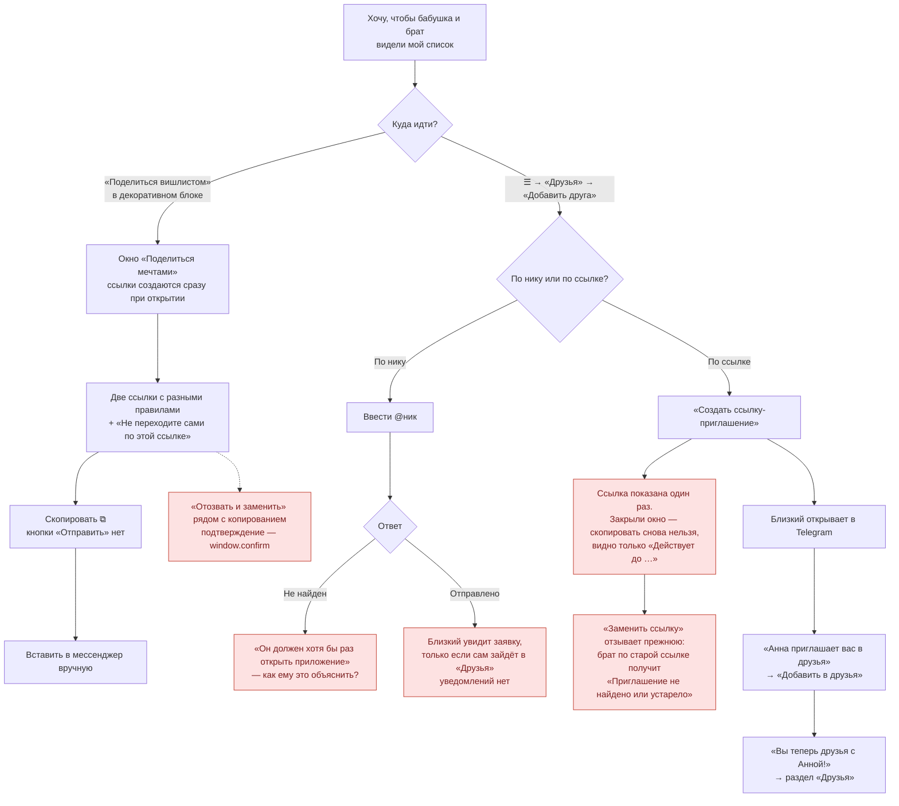
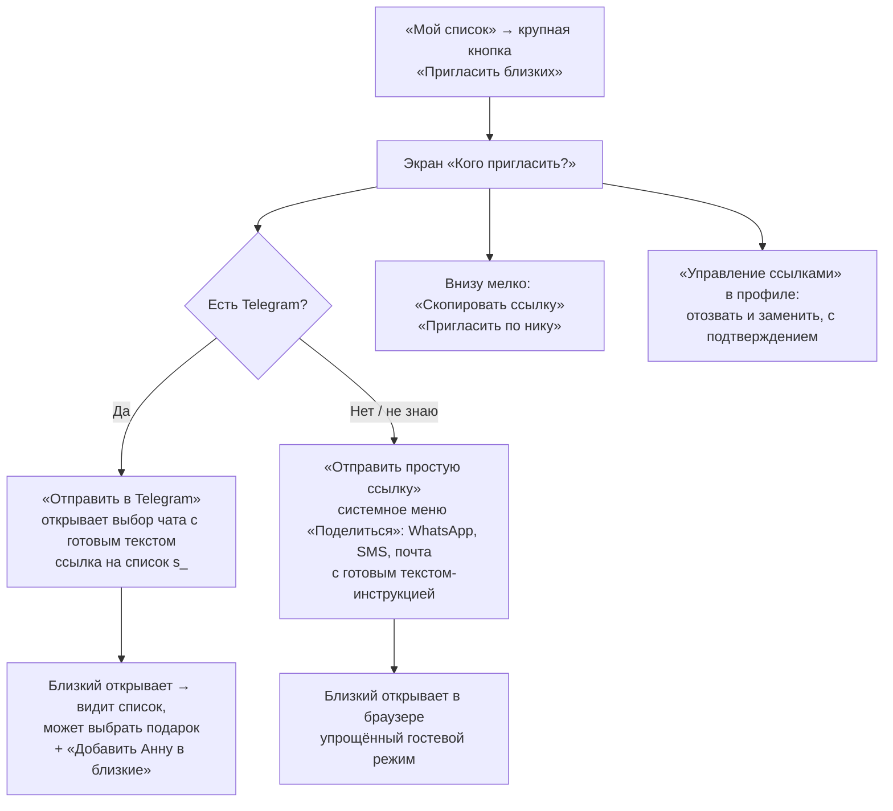

# Сценарий 6. Приглашение близких

Сейчас в продукте **четыре** способа дать доступ к списку, и они разнесены по разным местам:

| Способ | Где в интерфейсе | Что получает близкий | Нужен Telegram |
| --- | --- | --- | --- |
| Заявка по нику | «Друзья» → «Добавить друга» → «По нику» | Дружбу (взаимный доступ) после подтверждения | Да, и он уже должен был открыть приложение |
| Ссылка-приглашение `f_` | «Добавить друга» → «По ссылке» | Дружбу сразу после «Добавить в друзья» | Да |
| Ссылка на список `s_` | «Мой вишлист» → «Поделиться вишлистом» | Просмотр и бронь + кнопка «Добавить в друзья» | Да |
| Гостевая ссылка `#guest` | Там же | Просмотр и бронь по имени | Нет |

## Сейчас

### Проблемы

| ID | Проблема | Где |
| --- | --- | --- |
| IN-1 | Нет единой точки «Пригласить близких»: «Поделиться» живёт в декоративном блоке списка, «Добавить друга» — в другом разделе | `main.tsx:707-724, 624-630` |
| IN-2 | Пользователь должен понять разницу между «друзьями», «Telegram-ссылкой» и «гостевой ссылкой». Для семьи это лишние понятия | `forms.tsx:778-818` |
| IN-3 | Нет кнопки «Отправить» (Telegram share / системное меню «Поделиться»); только копирование, которое на телефоне иногда молча не срабатывает (ошибка `clipboard.writeText` проглатывается) | `forms.tsx:725-733` |
| IN-4 | Ссылку-приглашение `f_` нельзя скопировать повторно — в базе только хеш. Создание новой отзывает прежнюю, поэтому разосланные ранее приглашения ломаются | `friends.tsx:107, 134-137`, `worker/index.ts:540-555` |
| IN-5 | Заявка по нику требует, чтобы человек уже открывал приложение — для новичка это замкнутый круг | `worker/index.ts:468-473` |
| IN-6 | Нет уведомлений о заявке: получатель узнает, только открыв «Друзья»; на телефоне счётчик заявок виден лишь в спрятанном меню | `main.tsx:393-400` |
| IN-7 | Окно «Поделиться» молча создаёт обе ссылки при первом открытии (POST) — владелец мог просто посмотреть | `forms.tsx:747-748` |
| IN-8 | «Отозвать и заменить» стоит сразу под копированием, через `window.confirm` (ненадёжен в Telegram) | `forms.tsx:797-816` |
| IN-9 | Ошибка приглашения («не найдено или устарело», «Это ваше собственное приглашение») — без кнопки выхода из окна, кроме крестика | `friends.tsx:274-279` |
| IN-10 | Предупреждение «Не переходите сами по этой ссылке» — правильное, но владельцу ничто не мешает: при переходе он увидит статусы | `forms.tsx:790-795` |
| IN-11 | Дружба взаимная: пригласив бабушку в друзья, владелец тоже видит её список (обычно пустой) — лишний шум в «Друзьях» | `worker/index.ts:600-608` |

## Предложение

Одна кнопка **«Пригласить близких»** и один вопрос: «Есть ли у человека Telegram?». Под капотом — существующие механизмы, без новых сущностей.

**Ключевые изменения:**

- Единая точка входа «Пригласить близких» на главном экране и в пустом состоянии «Близких».
- Основное действие — «Отправить» (Telegram `openTelegramLink` на `t.me/share/url` в Mini App, `navigator.share` в браузере); «Копировать» — запасное, с видимым результатом «Скопировано» или «Не удалось — выделите и скопируйте».
- Готовый текст сообщения, понятный пожилому человеку: «Мария Ивановна, вот мой список желаний. Откройте ссылку и нажмите «Подарю» у того, что хотите подарить. Регистрироваться не нужно».
- Ссылку-приглашение `f_` сделать многоразовой на 30 дней и сохраняемой для повторного копирования (как уже сделано для ссылок на список) — или убрать отдельный `f_`, используя `s_`-ссылку с кнопкой «Добавить в близкие».
- «Отозвать» — только в «Управлении ссылками», со своим окном подтверждения.
- Переименовать «Друзья» в «Близкие» — ближе к семейному смыслу продукта.
